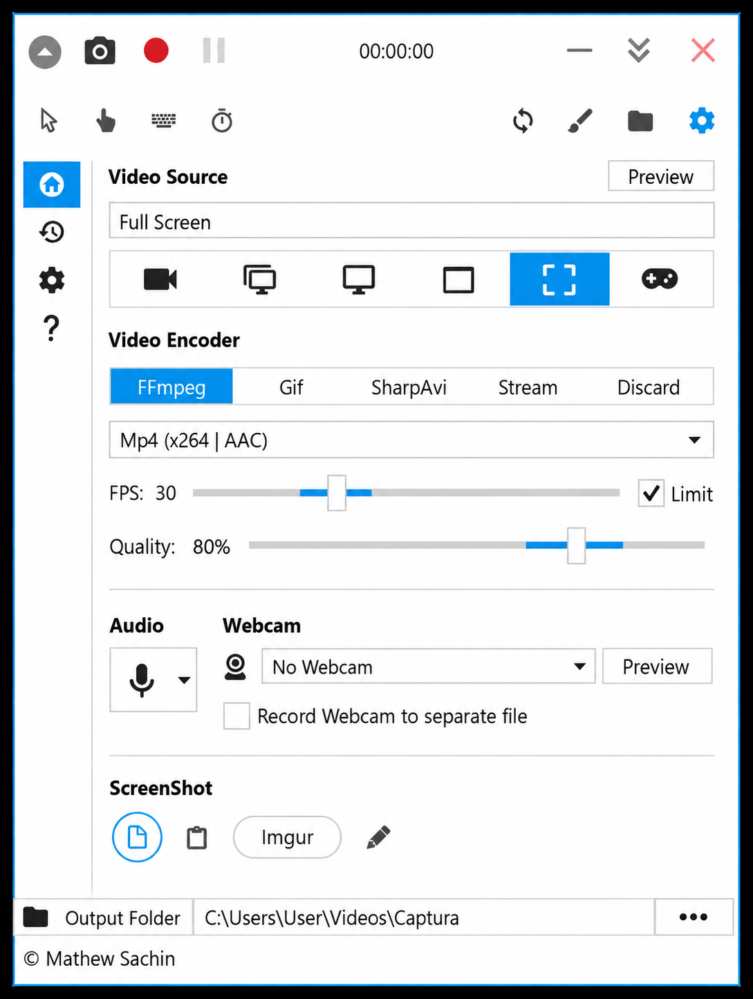
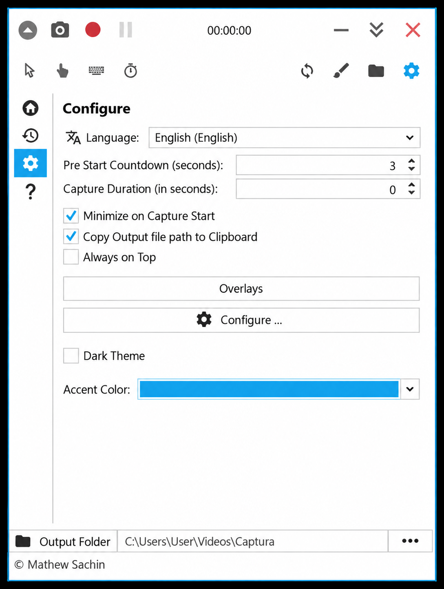
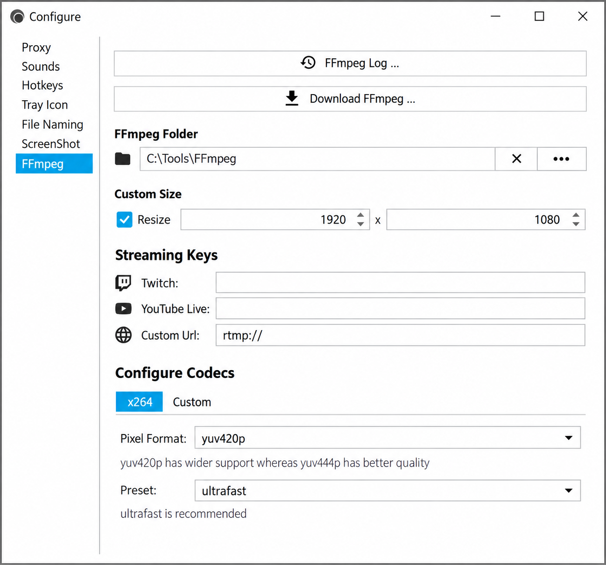

# Captura Screen Recorder - Windows Screen, Webcam, Audio, And Input Capture

> Captura Open Source preserves Captura Screen Recorder as an archived Windows recording project.
>
> The original application is no longer actively maintained, and the retained source should be treated as a reference implementation.

Captura Screen Recorder captures screens, windows, regions, webcams, audio, mouse pointers, clicks, and keystrokes. Captura Open Source retains the core C#, WPF, Windows capture, audio, overlay, and recording abstractions behind the original Captura software.

## Features

- Take screenshots.
- Record screencasts as AVI, GIF, or MP4.
- Capture a full screen, selected display, application window, or custom region.
- Include or hide the mouse pointer.
- Display mouse clicks and keystrokes.
- Mix microphone input with speaker output.
- Add webcam video to a recording.
- Apply text, image, censor, elapsed-time, and pointer overlays.
- Configure recording, audio, video, and mouse-overlay behavior.
- Use portable builds from supported historical releases.
- Control historical releases with configurable hotkeys and command-line verbs.

Captura Screen Recorder is both captura screen recording software and a reference for building a captura ffmpeg screen recorder. The retained projects expose recording contracts, image providers, video sources, audio providers, Windows capture services, and reusable overlay components.

### How Many Episodes Are In The Capture On Netflix?

Captura Screen Recorder has no episodes because it is software, not the television series named “The Capture.” It is not distributed as Netflix programming and has no seasons or episode count. Captura Open Source contains C# source for screen capture, recording, audio, overlays, and Windows integration.

## Why Captura?

Captura Screen Recorder combines several desktop-recording functions in one Windows application. It can record the desktop while mixing audio, showing input activity, adding overlays, and including webcam footage.

The Captura Open Source code separates platform contracts from recording implementations. Interfaces such as [`IRecorder`](src/Captura.Base/IRecorder.cs), [`IAudioProvider`](src/Captura.Audio/IAudioProvider.cs), and [`IVideoSourceProvider`](src/Captura.Base/Video/IVideoSourceProvider.cs) make the architecture useful for studying or extending captura software.

### Was The Capture Worth Watching?

Captura is not something to watch as a television program. Captura Screen Recorder is worth examining when the goal is to study an archived C# and WPF recording application, Windows capture APIs, audio pipelines, or composited overlays. Users seeking a maintained recorder should account for the archived status before relying on Captura Open Source in a production workflow.

## Screenshot And Screen Recording Features

Captura Screen Recorder supports screenshot and video workflows through dedicated image, video, and platform abstractions.

- Full-screen recording through [`FullScreenItem`](src/Screna/VideoItems/FullScreenItem.cs).
- Display recording through [`ScreenItem`](src/Screna/VideoItems/ScreenItem.cs).
- Window recording through [`WindowItem`](src/Screna/VideoItems/WindowItem.cs).
- Region selection through [`RegionItem`](src/Screna/RegionItem.cs).
- Screenshot capture through [`ScreenShot`](src/Screna/ScreenShot.cs).
- Windows screenshot integration through [`ScreenShot`](src/Captura.Windows/Capture/ScreenShot.cs).
- Cursor capture through [`MouseCursor`](src/Captura.Windows/Capture/MouseCursor.cs).
- Repeated-frame handling through [`RepeatFrame`](src/Captura.Base/Images/RepeatFrame.cs).
- Multiple recording streams through [`MultiRecorder`](src/Screna/MultiRecorder.cs).

The captura screen recorder for windows uses Windows-specific wrappers and native API bindings while keeping common recording contracts in Captura Base.

### How True Is The Series The Capture?

That question concerns a television drama and does not describe Captura Screen Recorder. Captura Open Source makes technical claims that can be traced to retained source files, including Windows capture classes, audio interfaces, image providers, recording types, and overlay implementations.

## Region Capture And Annotation

Captura Screen Recorder can compose captured frames with visual elements before they reach a writer. The retained Screna project includes:

- [`AroundMouseImageProvider`](src/Screna/ImageProviders/AroundMouseImageProvider.cs) for capture centered around pointer activity.
- [`OverlayedImageProvider`](src/Screna/ImageProviders/OverlayedImageProvider.cs) for composing overlays.
- [`CensorOverlay`](src/Screna/Overlays/CensorOverlay.cs) for obscuring selected content.
- [`CustomImageOverlay`](src/Screna/Overlays/CustomImageOverlay.cs) for adding images.
- [`ElapsedOverlay`](src/Screna/Overlays/ElapsedOverlay.cs) for displaying elapsed time.
- [`MousePointerOverlay`](src/Screna/Overlays/MousePointerOverlay.cs) for pointer rendering.
- [`TextOverlay`](src/Screna/Overlays/TextOverlay.cs) for textual information.

These components make Captura Open Source more than a basic screenshot implementation. They preserve the compositing foundation used by the captura open source screen recorder.

## Webcam And Audio

Captura Screen Recorder was designed to capture webcam video and record microphone or system audio. Webcam contracts remain in [`IWebcamCapture`](src/Captura.Base/Services/IWebcamCapture.cs), [`IWebcamItem`](src/Captura.Base/Services/IWebcamItem.cs), and [`IWebCamProvider`](src/Captura.Base/Services/IWebCamProvider.cs).

The audio model includes:

- [`IAudioSource`](src/Captura.Audio/IAudioSource.cs) for selectable audio inputs.
- [`IAudioProvider`](src/Captura.Audio/IAudioProvider.cs) for discovering and creating audio sources.
- [`IAudioFileWriter`](src/Captura.Audio/IAudioFileWriter.cs) for encoded output.
- [`AudioRecorder`](src/Screna/AudioRecorder.cs) for recording coordination.
- [`WaveFormat`](src/Captura.Audio/WaveFormat/WaveFormat.cs) for audio format information.
- [`AudioSettings`](src/Captura.Base/Settings/AudioSettings.cs) for audio configuration.

This architecture supports the historical captura webcam recorder and audio-recording workflows while keeping device handling separate from recording orchestration.

## Command-Line

Historical Captura releases provided separate graphical and command-line executables.

| Project | Executable |
|---|---|
| UI | `captura.exe` |
| Command-line | `captura-cli.exe` |

The graphical executable accepted options for resetting settings, starting in the system tray, disabling persistence, disabling hotkeys, and selecting a settings directory. The command-line application offered verbs for listing sources, starting recordings, taking screenshots, managing FFmpeg, displaying help, and printing version information.

> Command-line support was documented as beta and was not considered fully stable.

The selected Captura Open Source snapshot focuses on core recording projects and does not retain the original console project implementation.

## Overview

Captura Screen Recorder is organized around small interfaces and platform-specific implementations.

| Component | Purpose |
|---|---|
| [`Captura.Audio`](src/Captura.Audio/Captura.Audio.csproj) | Audio sources, providers, writers, and wave formats. |
| [`Captura.Base`](src/Captura.Base/Captura.Base.csproj) | Shared capture, imaging, service, settings, and video contracts. |
| [`Screna`](src/Screna/Screna.csproj) | Recording coordination, image providers, overlays, and video items. |
| [`Captura.Windows`](src/Captura.Windows/Captura.Windows.csproj) | Windows capture, native API bindings, screens, regions, and windows. |
| [`Captura.sln`](src/Captura.sln) | Visual Studio solution entry point. |

Windows integration is represented by [`Gdi32`](src/Captura.Windows/Native/Gdi32.cs), [`Kernel32`](src/Captura.Windows/Native/Kernel32.cs), and [`User32`](src/Captura.Windows/Native/User32.cs). Screen and window abstractions are implemented by [`ScreenWrapper`](src/Captura.Windows/ScreenWrapper.cs), [`Window`](src/Captura.Windows/Window.cs), and [`WindowProvider`](src/Captura.Windows/Capture/WindowProvider.cs).

### Repository Vocabulary

captura screen recorder, captura software, captura open source, captura open source screen recorder, captura screen recording software, captura screen recorder for windows, screen-recorder, screen-capture, windows, c-sharp, wpf, ffmpeg, webcam-recording, audio-recording, open-source

## Requirements

Captura Screen Recorder targets Windows and depends on Windows-specific capture and native API behavior. Review [System Requirements](docs/System-Requirements.md) before attempting to run or rebuild the application.

Development requires tooling compatible with the retained C# projects and solution. Platform behavior, device availability, codecs, audio endpoints, graphics support, and FFmpeg configuration can affect recording results.

## Installation

The retained repository includes documentation for setup and portable operation:

- Follow [Setup](docs/Setup.md) for installation guidance.
- Review [Portable](docs/Portable.md) for portable-build behavior.
- Read [FFmpeg](docs/FFmpeg.md) for encoder integration.
- Consult [Build](docs/Build.md) before compiling Captura Screen Recorder.

### From Source

Open [`src/Captura.sln`](src/Captura.sln) with compatible Visual Studio and .NET tooling. Review [`Directory.Build.props`](Directory.Build.props), [`Directory.build.targets`](Directory.build.targets), and [`build.cake`](build.cake) for shared build configuration.

The selected Captura Open Source tree is a curated subset of the historical project. Some original user-interface, command-line, codec, packaging, and integration projects are not present, so the retained solution may require corresponding restoration or project-reference adjustment before a complete historical build can succeed.

## Changelogs

Historical Captura development included v7.0.1, v8.0.0, and unfinished v9.0.0 documentation. The phrase captura v8 0.0 refers to the established v8 release line, while later documentation described v9 material as incomplete work in progress.

### Was The Capture Renewed For Season 4?

Captura Screen Recorder does not use television seasons and therefore was not renewed for season 4. The software used numbered releases instead, including v8.0.0 and planned v9.0.0 work. Captura Open Source is now an archived source-preservation project rather than an actively renewed product line.

## Known Issues

- The original Captura repository is no longer actively maintained.
- Historical command-line support was marked unstable.
- FFmpeg availability and configuration affect supported output formats.
- Windows capture behavior can vary with graphics hardware, drivers, displays, and application windows.
- Webcam and audio availability depend on installed devices and platform services.
- The selected source tree does not contain every project from the historical application.

## Docs

- [Build Notes](docs/Build.md)
- [FFmpeg](docs/FFmpeg.md)
- [Portable Operation](docs/Portable.md)
- [Setup](docs/Setup.md)
- [System Requirements](docs/System-Requirements.md)

## Contribute

Captura Open Source welcomes careful maintenance of the preserved Captura Screen Recorder code. Changes should remain focused on the retained C# recording architecture, Windows capture behavior, audio handling, overlays, documentation, and reproducible build configuration.

Follow [`.editorconfig`](.editorconfig), preserve the existing project boundaries, and avoid claiming that a patch was tested unless the relevant build or recording workflow was actually executed.

## License

See [LICENSE](LICENSE).
